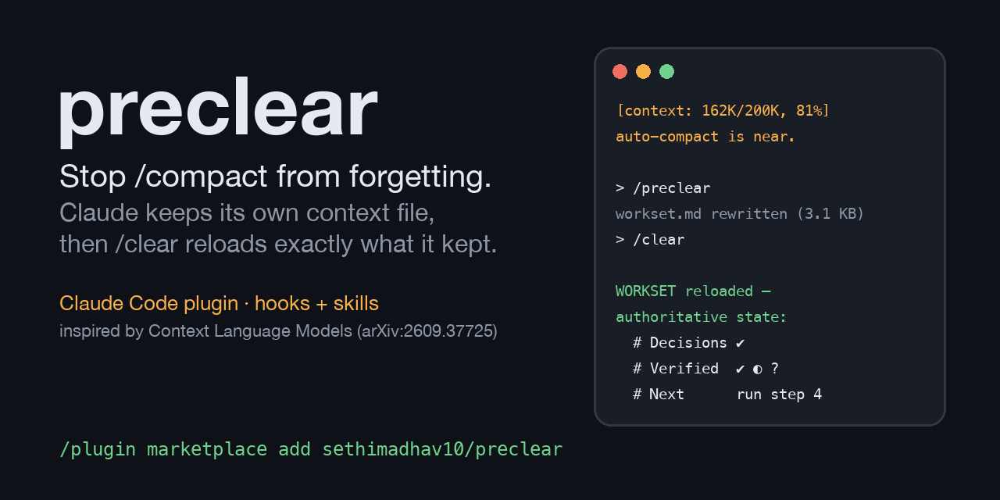
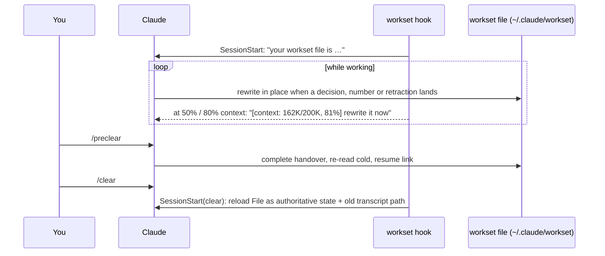

<p align="center">
  
</p>

# preclear

**Stop `/compact` from forgetting the thing that mattered.** preclear is a Claude Code plugin that
lets Claude curate its own context. It keeps a small working-memory file, the *workset*, and rewrites
it as the work goes. When the context window fills, you type `/preclear` and then `/clear`, and the
fresh window starts from exactly what Claude chose to keep. No harness-written summary, and nothing
to copy and paste.

[](https://github.com/sethimadhav10/preclear/actions/workflows/test.yml)


```text
/plugin marketplace add sethimadhav10/preclear
/plugin install preclear@preclear
```

---

## The problem

Long Claude Code sessions hit the context limit. Auto-compact (or `/compact`) then replaces the
conversation with a summary. The summary is written by something that doesn't know which detail you
need next. The usual casualties:

- the number that took an hour to measure, now without what it measured
- the decision you made at 2 pm, now an "option"
- the fix that must only go one way, now remembered backwards
- the thing that was tried and failed, so it gets tried again

## The idea

In *Context Language Models* (Shao et al., UW, Meta and others,
[arXiv:2609.37725](https://arxiv.org/abs/2609.37725)), the model manages its own context as a file
it can edit freely, instead of a harness deciding what survives.

Claude Code doesn't let a model rewrite its live window, so preclear builds the closest thing it can:

| | `/compact` (built in) | `/preclear` → `/clear` |
|---|---|---|
| Who decides what survives | a summariser, at the last moment | Claude, continuously, while it still knows why |
| What the new window gets | a narrative summary | a structured state file: decisions, verified numbers, traps, next action |
| Knows how full it is | no | yes: a hook reports context size at 50% and 80% |
| Old transcript | gone from view | path handed over so a missing detail can be **grepped**, not reread |
| Can you read and edit it? | no | yes, it's a Markdown file on disk |

## How it works



- **One hook** (`hooks/workset.py`, Python standard library only) on `SessionStart`,
  `UserPromptSubmit`, `PostToolUse`, `PreCompact` and `PostCompact`. It must be fast and silent, and
  it always exits 0. It writes only inside `~/.claude/workset/`.
- **Three skills.** `workset` (keep the file), `preclear` (make it complete before `/clear`) and
  `precompact` (write a paste-back prompt for a *different* session or a teammate).
- If auto-compact fires anyway, the hook re-injects the workset after it, and **the workset beats
  the summary** wherever they disagree.
- `/preclear` also prints a **resume link**: a one-click script that opens a fresh window in the
  same folder with the workset loaded (macOS `.command`, Linux `.sh`), next to
  `claude --resume <id>` for the whole old chat.

## What a workset looks like

```markdown
# Goal       Migrate billing to the v2 API without double-charging anyone.
# Decisions  3 Nov: "ship behind a flag, 5% first" (user). Rollback owner: OPEN.
# Verified   ✔ 1,204 subscriptions on legacy plans (SELECT in notes/counts.sql)
             ◐ v2 webhook retries 3×, from the vendor docs, not tested
# Ruled out  Batch backfill: hits the rate limit at ~400/min (tried, 429s)
# Traps      THE V2 IDEMPOTENCY KEY IS PER CUSTOMER, NOT PER INVOICE. Never reuse across invoices.
# Next       Write the dry-run diff for the 5% cohort; don't touch prod.
# Pointers   notes/STATE.md · notes/counts.sql · PR #412
```

The tags are the important part: **✔ verified · ◐ reported, unverified · ? assumed.** A claim
without a tag reads as verified, and a fresh window can't tell the difference.

## Install

**As a plugin (recommended):**

```text
/plugin marketplace add sethimadhav10/preclear
/plugin install preclear@preclear
```

Plugin skills are namespaced: `/preclear:preclear`, `/preclear:workset`, `/preclear:precompact`.
Claude also invokes them on its own when the hook nudges it.

**Manual install** (plain `/preclear`, no plugin system):

```bash
git clone https://github.com/sethimadhav10/preclear && cd preclear && ./install.sh
```

`install.sh` backs up `settings.json`, copies the hook and skills into `~/.claude`, adds the hook
entries without touching your existing ones, and checks that the hook answers. `./uninstall.sh`
reverses it and keeps your worksets.

Then open a **new** session. It should say `Workset file for this session: …`.

**On a 1M-token context window**, set `export WORKSET_WINDOW=1000000` so the 50% and 80% nudges
land at the right place. The default is 200K. The hook switches to 1M by itself once a session goes
past 200K, but by then the early nudges have already fired.

Requires `python3` (3.8+). CI runs the tests and an install/uninstall round-trip on macOS and Linux (Python 3.8 and 3.12). Windows is untested.

## Use

1. Work normally. Claude keeps the workset current. At 50% and 80% the hook tells it to rewrite.
2. When it's long, or Claude says the workset is current: type **`/preclear`**.
3. Claude finishes the file, re-reads it cold, and prints the resume link.
4. Type **`/clear`**. The fresh window starts with the workset and the path to the old transcript.

## Settings

| Variable | Default | What it does |
|---|---|---|
| `WORKSET_WINDOW` | `200000` | Your context window in tokens, used for the 50% / 80% readout |
| `WORKSET_DIR` | `$CLAUDE_CONFIG_DIR/workset` or `~/.claude/workset` | Where worksets live |

## What's honest to say about it

- **This is not a reproduction of the paper.** The paper trains and evaluates models that manage
  their own context, and reports gains, e.g. 11.4% higher accuracy with 21.5% fewer FLOPs on
  BrowseComp-Plus when building CLMs zero-shot from existing models. preclear borrows the idea for
  Claude Code. **It has not been benchmarked.** Not affiliated with the authors, and it uses none of
  their code.
- The workset is only as good as what Claude writes into it. The skills make it write state, not
  story: tagged claims, decisions in your words, traps in capitals. Read it now and then.
- A file the model writes and that gets re-injected is a place where a prompt injection could
  persist. Don't let untrusted content flow into it unread.
- Never put secrets in a workset. It is a plain file in your home directory.

## Tests

```bash
python3 -m unittest discover tests -v
```

15 end-to-end tests feed the hook the same JSON Claude Code sends, in a throwaway directory. They
cover the 50% and 80% nudges, firing once per band, 1M auto-detection, ignoring subagents, carry-over
across `/clear` (with a fake `claude` process), the resume link, and garbage input exiting 0.

## Files

```text
.claude-plugin/plugin.json        plugin manifest
.claude-plugin/marketplace.json   lets `/plugin marketplace add sethimadhav10/preclear` work
hooks/hooks.json                  hook wiring for the plugin
hooks/workset.py                  the hook (stdlib Python)
skills/workset/SKILL.md           keep the file current
skills/preclear/SKILL.md          get ready for /clear
skills/preclear/resume_link.py    one-click resume link
skills/precompact/SKILL.md        paste-back handover for another session
install.sh / uninstall.sh         manual install without the plugin system
tests/test_hook.py                end-to-end tests
```

## Credit

Idea: *Context Language Models*, Rulin Shao, Shannon Zejiang Shen, Junjie Oscar Yin, Yuetai Li,
Minheng Wang, Hamish Ivison, Radha Poovendran, Nathan Lambert, Teng Xiao, Mike Lewis, Wen-tau Yih,
Luke Zettlemoyer, Pang Wei Koh. [arXiv:2609.37725](https://arxiv.org/abs/2609.37725) (2026).
Official code: [facebookresearch/context-language-models](https://github.com/facebookresearch/context-language-models).

MIT licensed. Issues and PRs welcome, especially Linux and Windows reports, and before/after
examples of a workset surviving a `/clear`.

<sub>Keywords: Claude Code plugin, Claude Code hooks, Claude Code skills, /compact alternative,
auto-compact, context compaction, context window management, context engineering, context rot,
agent memory, working memory for LLM agents, long-running coding agent sessions, session handover,
Context Language Models, CLM.</sub>
